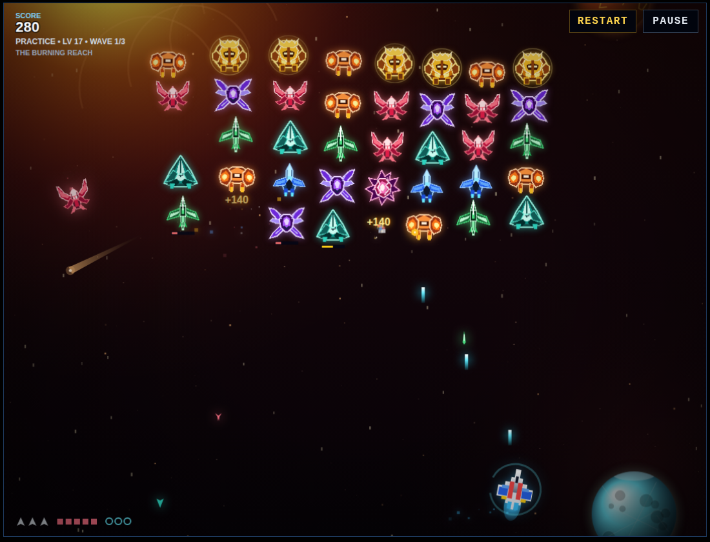
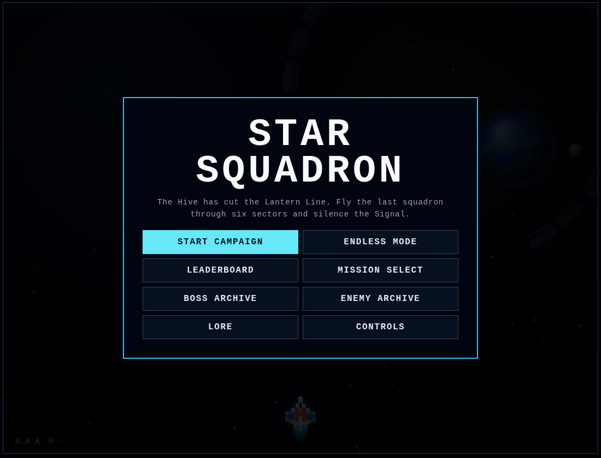

# Star Squadron

A Galaga-inspired Electron arcade shooter with a 30-level campaign, Endless Mode, multi-wave missions, permanent ship upgrades, nine enemy classes, six cycling command bosses, coordinated enemy tactics, lore archives, local leaderboards, and terminal/debug diagnostics.



Built with Electron and a plain HTML5 canvas (no game engine or framework). The game logic lives in `game.js`, score rules in `score-rules.js`, and the Electron shell in `main.js`. Current version: **2.11**. See [CHANGELOG.md](CHANGELOG.md) for version history.

Requires Node.js 22 or newer.

## Run

```bash
npm install
npm start
```

For extra Electron/Chromium logging:

```bash
npm run start:debug
```

Run the score regression tests without launching Electron:

```bash
npm test
```

## Story

The Hive, a living swarm that grows its warships out of whatever it consumes, has cut the **Lantern Line**, a chain of six colony systems. Every Hive craft answers to one broadcast, **the Signal**, and the Signal comes from **Queen Vesper**. You fly the last squadron, and your route to her runs through six sectors. Each sector is held by a command ship the Hive grew around something it took from the colonies.

| Levels | Sector | Command ship | Grown from | New castes |
| --- | --- | --- | --- | --- |
| 1–5 | The Outer Gate | The Warden | Bastion Station, the Line's first defense | Needlewing |
| 6–10 | The Drift Lanes | Widow Vector | VECTOR, the colony traffic AI | Void Weaver |
| 11–15 | The Convoy Graveyard | Iron Maw | The lost evacuation convoys | Rift Rammer, Shrapnel Kamikaze |
| 16–20 | The Burning Reach | Solar Regent | A living star | Sun Bomber |
| 21–25 | The Silent Orbit | Null Bishop | The deep-space observatory | Phantom Wasp |
| 26–30 | The Hive Heart | Queen Vesper | — | — |

Killing Vesper silences the Signal, but a new queen is already growing. That is **Endless Mode** (The Regrown Hive), where the command ships return stronger.

The sector name appears on the HUD, in a banner when you enter it, on briefings, and on the upgrade screen before you move on.



## Controls

- Move: `WASD` or Arrow Keys
- Fire: `Space` or `Enter`
- Menu navigation: `WASD` or Arrow Keys
- Select menu item: `Space` or `Enter`
- Pause / resume: `P` or `Esc`
- Skip a NEW CONTACT or boss briefing: `Space` or `Enter`
- Mute / unmute: `M`
- Restart run: `R` twice during combat (once from the pause or Game Over screen)
- Hidden debug screen: `↑ ↑ ↓ ↓ Space` on any menu, the pause screen or Game Over (not during live combat)
- After unlocking it: `F6` forces a Forward Assault, `F8` toggles the live debug HUD

## Campaign

- 30 campaign levels.
- Boss encounter every fifth level.
- Regular missions use multiple waves.
- Boss stages use escort waves before the command ship.
- One permanent ship upgrade is chosen after each cleared level.
- Direct Mission Select starts receive an appropriate campaign loadout.
- Shields, hull, fire control, laser strength, and thrusters support different builds.
- Enemy fire colors are tied to enemy class.
- Weapons are locked during formation entry, between waves, new-contact briefings, boss briefings, and boss entry.
- New enemy types receive a timed pre-level **NEW CONTACT** briefing.

## Enemy teamwork

- Skitter Scouts make probe runs between coordinated attacks.
- Crimson Mantises perform paired scissor attacks.
- Crown Beetles can lead spearheads with hooked escorts.
- Needlewings cover another attacker by targeting likely escape lanes.
- Void Weavers descend in mirrored pairs and compress firing lanes toward the center.
- Rift Rammers execute readable two-sided pincers.
- Shrapnel Kamikazes dive to a telegraphed detonation point and burst into radial fire with an escape wedge.
- Sun Bombers deny one side of the arena while another unit pressures the opposite side.
- Phantom Wasps use feint-and-hunt pair tactics.

## Bosses

Bosses cycle every five levels. The campaign culminates at Level 30; Endless Mode repeats the command roster afterward with continued scaling.

- The Warden — gate-lane control
- Widow Vector — predictive crossfire
- Iron Maw — staggered heavy lanes
- Solar Regent — rotating radial pressure
- Null Bishop — spiral pressure plus aimed fire
- Queen Vesper — royal fan volleys mixed with hunter shots

Boss briefings display the command ship, title, lore, and a visible countdown before combat begins.

## Diagnostics

Renderer logs are forwarded to the terminal running `npm start`. Important game-state changes, team tactics, hits, respawns, game over, boss phases, Forward Assault events, leaderboard saves, and runtime errors are logged there.

## Forward Assault testing

Forward Assault is a rare normal encounter event. It can be forced during a live non-boss formation with `F6` or from **DEBUG / TEST**. The forced event still waits for a valid formation and uses the normal `3 → 2 → 1` warning before launching.

## Endless Mode

**ENDLESS MODE** starts a fresh run and continues beyond Level 30. Bosses still appear every five levels and cycle through the six-boss command roster. Enemy scaling continues after Level 30 at a slower rate than campaign scaling.

After every permanent upgrade reaches maximum rank, the between-level upgrade screen becomes **Veteran Resupply** instead. It restores hull and shields, adds one life up to five, awards 5,000 points, and advances the run.

## Local leaderboard

The leaderboard is stored locally on the device and combines player entries with three seeded scores:

Campaign: ACE — 250,000; VIPER — 220,000; NOVA — 195,000.

Endless: ACE — 500,000; VIPER — 440,000; NOVA — 390,000.

A callsign can be entered **after Game Over or campaign victory**, and the completed Campaign or Endless score can be saved. The two modes have separate top-ten lists; practice runs and mid-run scores cannot be submitted.

If an eligible completed run beats the top score for its mode, the final results screen shows a **NEW HIGH SCORE** banner. Records are only checked once the run ends, never mid-combat.

## Debug / Test tools

Open **DEBUG / TEST** with the secret code `↑ ↑ ↓ ↓ Space`. It reports:

- Forward Assault state
- Current run mode

It can also force a Forward Assault, toggle the live debug HUD, and play any animation in the game from the animation viewer.

## Tests

`npm test` runs four scripts in `scripts/` that load the game in a Node `vm` with a stubbed DOM and canvas, so they run without Electron:

- `test-final-scores.js` — final-score and new-record rules
- `test-renderer-state.js` — game state and leaderboard lifecycle
- `test-boss-progression.js` — boss escort waves across all six bosses
- `test-balance.js` — leaderboard cap, no score-based extra lives, boss checkpoints, escort score decay

## License

MIT
